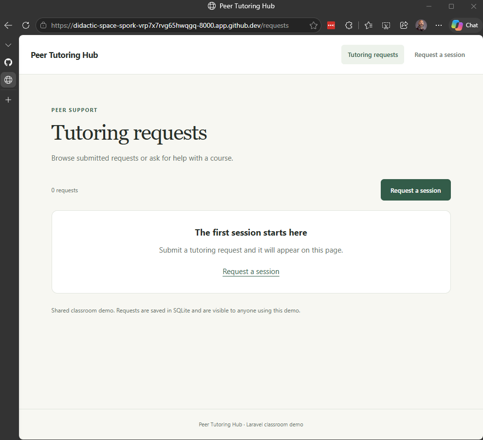
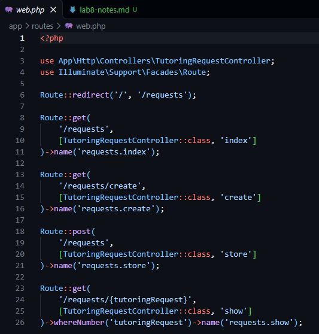
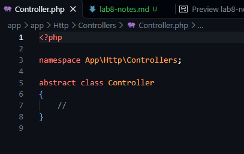
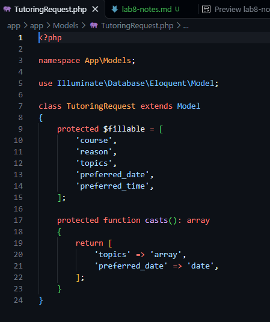
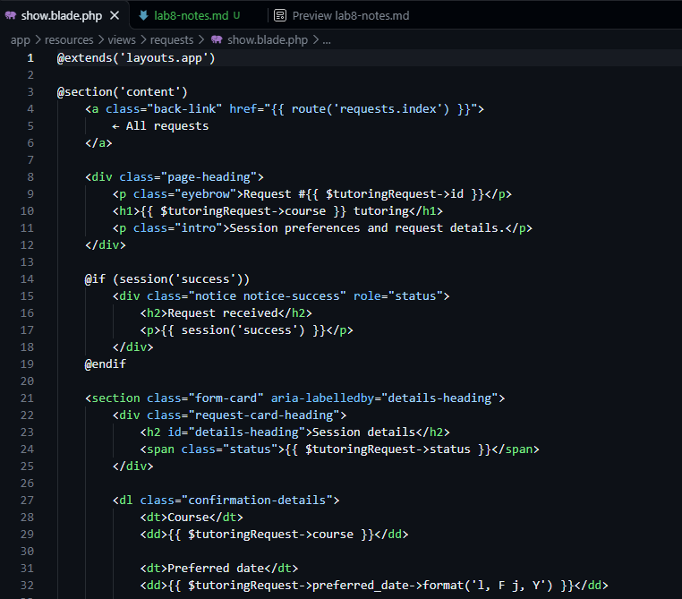

# Lab 8 – Laravel MVC Demo Notes

**Course:** IS 6465-090 Web Based Applications
**Student:** DJ
**Repository:** chinmaythorat92/peer-tutoring-laravel-demo (Laravel 12, PHP, Blade, SQLite)
**Codespace:** https://didactic-space-spork-vrp7x7rvg65hwqgq.github.dev/
**Codespaces App:** https://didactic-space-spork-vrp7x7rvg65hwqgq-8000.app.github.dev/

> All file paths below are relative to the Laravel `app/` folder inside the repository (`peer-tutoring-laravel-demo/app`).

---

## Part 1 – Running the Application

I created a Codespace from the starter repository and followed the README setup:

```bash
cd app
composer install
cp -n .env.example .env
sed -i "s|^APP_URL=.*|APP_URL=https://${CODESPACE_NAME}-8000.${GITHUB_CODESPACES_PORT_FORWARDING_DOMAIN:-app.github.dev}|" .env
php artisan config:clear
php artisan key:generate
touch database/database.sqlite
php artisan migrate
php artisan serve --host=0.0.0.0 --port=8000
```

I opened port 8000 from the Ports panel and completed the README walkthrough:

- Opened the app and landed on the **Tutoring requests** list (`/` redirects to `/requests`).
- Clicked **Request a session**, chose a course, a future date, a description, at least one topic, and a preferred time, then clicked **Request session**.
- Saw the **Request received** confirmation with my saved request details.
- Returned to **All requests** and clicked my request to view it again.
- Tested validation: no topic selected, a past date, and a description under 10 characters. Each produced a specific error message, and the form kept my other entries.
- Confirmed storage with `php artisan tinker` → `App\Models\TutoringRequest::count();`

---

## Part 2 – Exploring MVC

### 1. Business purpose

The Peer Tutoring Hub lets students ask for help with a course. A student picks a course (IS 6465, IS 6495, or IS 6570), describes what they need help with, chooses topics (exam review, practice problems, study plan), and gives a preferred date and time of day. Requests are saved so they can be reviewed, and each new request starts with a status of **Pending review**. The business goal is to connect students who need help with peer tutors.

### 2. A route

In `routes/web.php`:

```php
Route::get('/requests/create', [TutoringRequestController::class, 'create'])
    ->name('requests.create');
```

This route runs when a user goes to `/requests/create`, which happens when they click **Request a session** in the navigation bar or on the list page. It maps a `GET` request for that URL to the controller's `create()` method. The route also has a name (`requests.create`), so Blade templates link to it with `route('requests.create')` instead of hard-coding the URL.

### 3. A controller

`app/Http/Controllers/TutoringRequestController.php` handles the whole tutoring request workflow. It has four actions:

- `index()` loads all requests (newest first) and returns the list view.
- `create()` returns the form view and passes in the allowed courses, topics, and times.
- `store()` validates the submitted form, saves a new request through the model, and redirects to the details page with a success message.
- `show()` receives one request and returns the details view.

The controller is the coordinator. It does not write SQL or HTML itself. It checks the input, asks the model to read or save data, and decides which view or redirect to send back. The validation rules in `store()` are where the business rules live: the course must be one of the listed courses, the description must be 10–500 characters, 1–3 distinct topics are required, and the date must be today or later.

### 4. A model

`app/Models/TutoringRequest.php` represents one tutoring request, which is one row in the `tutoring_requests` table. The business data is the course, the reason (what the student needs help with), the selected topics, the preferred date, the preferred time, and the status.

The model extends Laravel's Eloquent `Model`, so it gets methods such as `create()`, `orderByDesc()`, and `get()` without me writing any SQL. `$fillable` lists the fields that may be mass-assigned from the form. `casts()` converts `topics` between a PHP array and JSON in the database, and turns `preferred_date` into a date object so the view can call `->format()`. The table itself is defined in the migration `database/migrations/*_create_tutoring_requests_table.php`, which also sets `status` to default to `'Pending review'`.

### 5. A view (Blade template)

`resources/views/requests/create.blade.php` is the **Request a tutoring session** page. The user sees a form with a course dropdown, a date picker, a description textarea, topic checkboxes, and preferred-time radio buttons, and submits it with **Request session**.

The template extends the shared layout (`@extends('layouts.app')`) so it gets the header, navigation, and footer automatically. It loops over the courses, topics, and times sent by the controller (`@foreach`), includes a CSRF token (`@csrf`), shows field-level error messages (`@error`), and refills the user's previous answers after a failed submission (`old('course')`, `@selected`, `@checked`).

### 6. Request flow through MVC – submitting a tutoring request

1. **Browser:** The student fills out the form at `/requests/create` and clicks **Request session**. The form sends `POST /requests`.
2. **Route:** In `routes/web.php`, `Route::post('/requests', [TutoringRequestController::class, 'store'])` matches the request and calls the controller.
3. **Controller – validation:** `TutoringRequestController::store()` runs `$request->validate(...)`. If anything fails, Laravel automatically redirects back to the form with the error messages and the old input, and the form view shows them.
4. **Model / database:** If validation passes, the controller calls `TutoringRequest::create([...])`. Eloquent turns the topics array into JSON, inserts a row into the `tutoring_requests` table in SQLite, and returns the new model with its ID. The database fills in `status = 'Pending review'` and the timestamps.
5. **Controller – redirect:** The controller redirects to `/requests/{id}` (`requests.show`) and flashes the message *"Your tutoring request has been received."*
6. **Route + route model binding:** The browser requests `GET /requests/{id}`. The route `/requests/{tutoringRequest}` only accepts a number. Laravel automatically looks up that ID through the `TutoringRequest` model and returns a 404 if it doesn't exist.
7. **Controller:** `show(TutoringRequest $tutoringRequest)` receives the loaded record and passes it to the view.
8. **View:** `resources/views/requests/show.blade.php` renders the **Request received** notice and a list of the course, date, time, topics, and description. Blade's `{{ }}` escapes the output. The finished HTML goes back to the browser.

In short: **Route** (`POST /requests`) → **Controller** (`store()` validates) → **Model** (`TutoringRequest::create()` → SQLite) → redirect → **Route** (`GET /requests/{id}`) → **Controller** (`show()`) → **View** (`requests/show.blade.php`).

### 7. Comparison with my course project (Lab 6/7 architecture)

My course project uses procedural PHP with PDO and SQLite. Its layers are separated by folder and by convention:

| Responsibility | Course project (Lab 6/7) | Laravel demo |
|---|---|---|
| Routing | One PHP file per URL (`php/request-form.php`, `php/process-request.php`, …) plus `php/router.php` that only blocks internal folders | `routes/web.php` maps HTTP method + URL to a controller method |
| Request handling | Page scripts such as `process-request.php` check `$_SERVER['REQUEST_METHOD']`, call the service, and redirect | `TutoringRequestController` actions |
| Validation and business logic | `services/requestService.php` (`validateSubmission()`, `submitRequest()` with a transaction) | `$request->validate()` rules in the controller |
| Data access | `repositories/requestPDO.php` with hand-written prepared SQL | Eloquent model `TutoringRequest` |
| Schema | `database/setup-database.sql` | Migration file + `php artisan migrate` |
| Presentation | PHP pages with `includes/header.php`, `nav.php`, `footer.php` and `htmlspecialchars()` | Blade layout + `@extends`/`@section`, automatic `{{ }}` escaping |

Both apps follow the same idea: keep presentation, business rules, and database code apart. In my project I do that through folders and discipline. Laravel builds those boundaries into the framework.

**One benefit of Laravel:** It provides a lot that I currently write by hand. Routes are listed in one file, so I can see every URL the app responds to. Validation errors and old input go back to the form automatically. CSRF protection is one directive (`@csrf`), and Blade escapes output by default. Route model binding even gives a 404 for a missing ID. My Lab 6 README specifically lists missing CSRF tokens as a limitation, and Laravel gives me that protection without extra work.

**Why we aren't converting the project now:** Laravel hides much of what the course is teaching. In my project I write the PDO prepared statements, the transaction that creates a student and request together, the JOIN between `students` and `tutoring_requests`, and the escaping myself, so I understand what each layer actually does. Converting now would also mean learning Composer, Artisan, Eloquent, migrations, and Blade in the last weeks of the term. It could break working features and our approved two-table design (the demo uses one table and no student records). The Lab 7 skills also require that we keep procedural PHP and avoid introducing a framework. It makes more sense to learn the fundamentals first and then see how a framework automates them.

---

## Part 3 – Evidence of Completion

### Screenshot of the running application



### One file from each MVC area

| MVC area | File | What it shows |
|---|---|---|
| **Route** | `routes/web.php` | Five route definitions: `/` redirects to `/requests`; `GET /requests` → `index`; `GET /requests/create` → `create`; `POST /requests` → `store`; `GET /requests/{tutoringRequest}` (numbers only) → `show`. Each route is named, e.g. `requests.store`. |
| **Controller** | `app/Http/Controllers/TutoringRequestController.php` | Constants for the allowed courses, topics, and times; `index`, `create`, `store`, and `show` actions; validation rules with custom error messages; `TutoringRequest::create()` and a redirect with a flash message. |
| **Model** | `app/Models/TutoringRequest.php` | An Eloquent model with `$fillable` (course, reason, topics, preferred_date, preferred_time) and `casts()` (`topics` → array, `preferred_date` → date). |
| **View** | `resources/views/requests/show.blade.php` | Extends `layouts.app`; shows the "Request received" success notice from the session and the course, formatted date, time, topics (`implode`), description, and status. |






### Reflection

Laravel made the request lifecycle much easier to follow. In my Lab 6/7 project, finding out what happens on a form submit means opening the page script, then the service, then the repository. In Laravel, `routes/web.php` lists every URL the app responds to in one place, and each route points straight to a named controller method. I could also see clearly how much the framework handles for me. Validation that sends errors and old input back to the form, CSRF tokens, escaped output, and a 404 for a missing record all take many lines of code in my project but only a line or two here. The confusing part was the "magic." Eloquent's `create()` writes the SQL I usually write myself. Route model binding turns `{tutoringRequest}` into a database record without visible code. The `casts()` array quietly converts JSON and dates. The project also has many folders and tools (Composer, Artisan, migrations, `.env`) that I had to learn just to start the app. Because I've already built the same features by hand, I understood what Laravel was automating. I think learning it in the opposite order would have been much more confusing.
